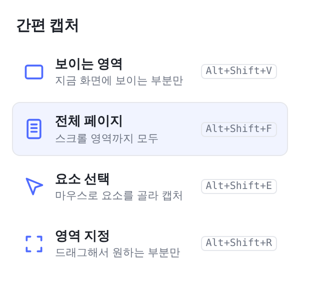
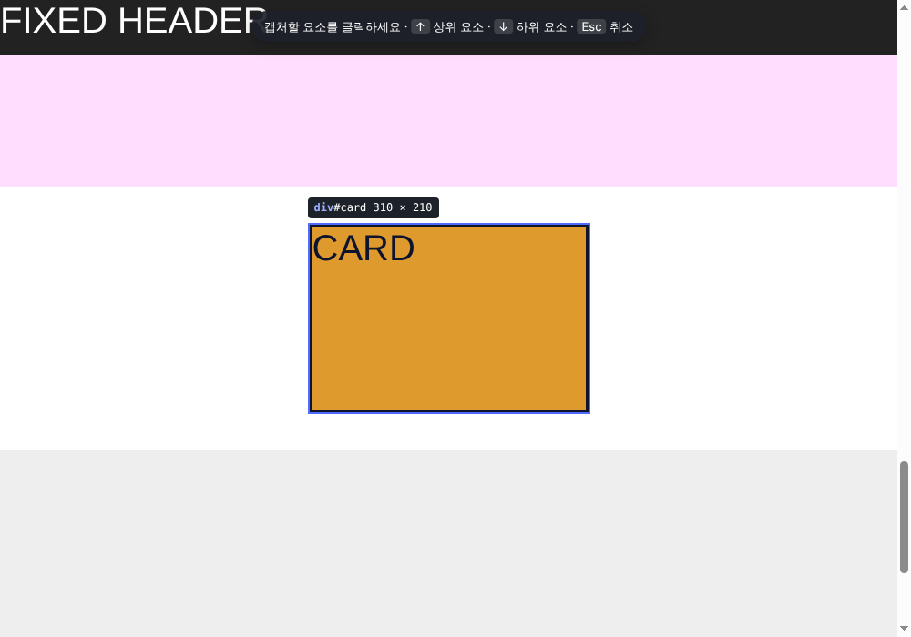
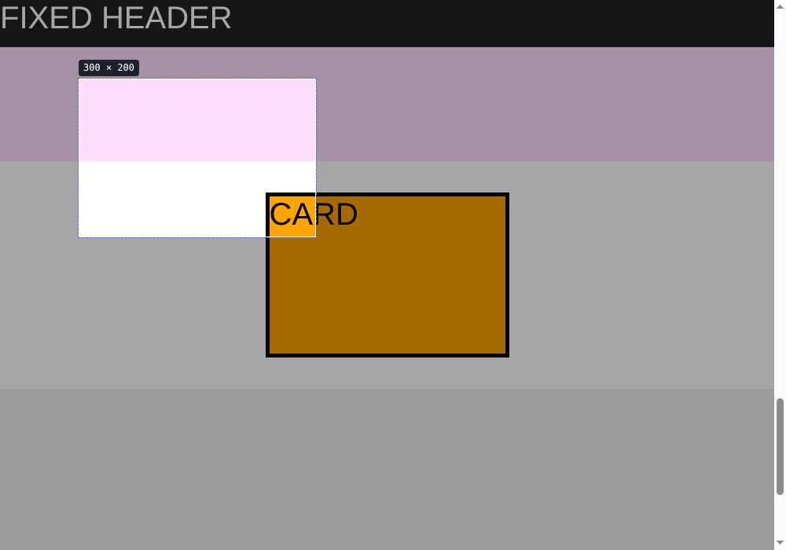
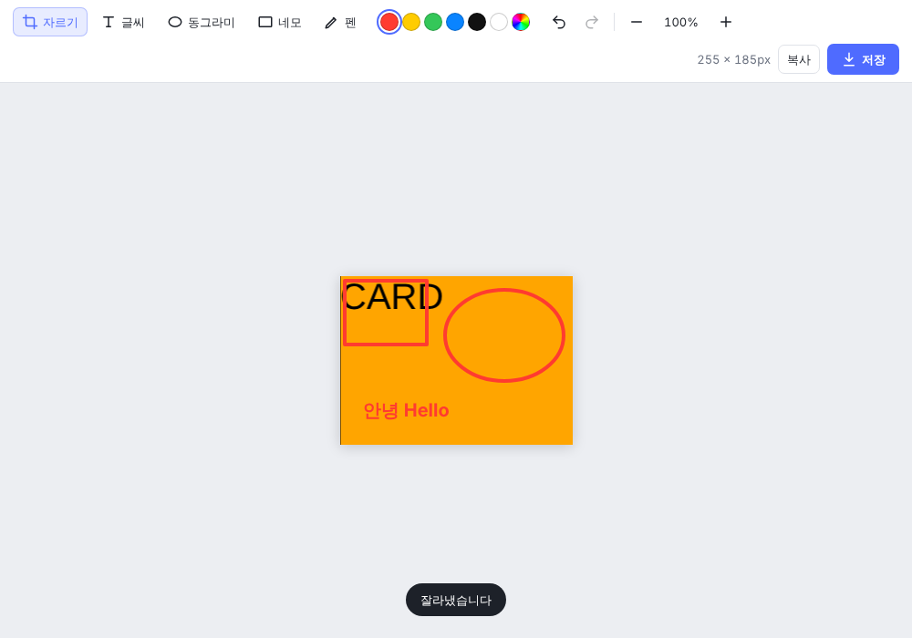

# 간편 캡처 (크롬 확장 프로그램)

웹 페이지를 네 가지 방식으로 캡처하고, 바로 간단히 편집해서 PNG로 저장하는 크롬 확장 프로그램입니다.
빌드 과정 없이 폴더 그대로 크롬에 올려서 쓸 수 있습니다 (Manifest V3, 순수 JS/HTML/CSS).

## 화면

| 팝업 | 요소 선택 | 영역 지정 |
| --- | --- | --- |
|  |  |  |



## 설치 방법 (압축해제된 확장 프로그램 로드)

1. 이 저장소를 내려받아(`git clone` 또는 Code → Download ZIP 후 압축 해제) 폴더를 컴퓨터의 원하는 위치에 둡니다.
2. 크롬 주소창에 `chrome://extensions` 를 입력해 엽니다.
3. 오른쪽 위 **개발자 모드** 스위치를 켭니다.
4. **압축해제된 확장 프로그램을 로드합니다** 버튼을 누르고, `manifest.json` 이 들어 있는 이 폴더를 선택합니다.
5. 툴바의 퍼즐 아이콘에서 **간편 캡처** 옆 핀을 눌러 고정하면 편합니다.

코드를 수정한 뒤에는 `chrome://extensions` 에서 확장 카드의 새로고침(↻) 버튼을 누르고, 캡처할 탭도 새로고침해 주세요.

## 캡처 방식

| 방식 | 설명 | 단축키 |
| --- | --- | --- |
| 보이는 영역 | 지금 화면에 보이는 부분만 캡처 | `Alt+Shift+V` |
| 전체 페이지 | 페이지를 끝까지 스크롤하며 여러 장을 찍어 한 장으로 이어 붙임 | `Alt+Shift+F` |
| 요소 선택 | 개발자 도구처럼 마우스를 올린 요소가 강조됨. 클릭하면 그 요소만 캡처. `↑` 상위 요소, `↓` 하위 요소, `Esc` 취소 | `Alt+Shift+E` |
| 영역 지정 | 화면 위를 드래그해서 원하는 부분만 캡처. `Esc` 취소 | `Alt+Shift+R` |

단축키는 `chrome://extensions/shortcuts` 에서 바꿀 수 있습니다.
캡처가 끝나면 새 탭에 편집기가 열립니다.

## 편집기

- **자르기** (`C`): 드래그로 남길 영역을 고른 뒤 `Enter` 또는 "자르기 적용"
- **글씨** (`T`): 원하는 곳을 클릭하고 입력. `Enter` 확정, `Shift+Enter` 줄바꿈, `Esc` 취소
- **동그라미** (`O`), **네모** (`R`): 드래그해서 그리기. `Shift` 를 누르면 정원/정사각형
- **펜** (`P`): 자유 곡선
- 색상(기본 6색 + 사용자 지정), 선 두께, 글자 크기 선택
- 실행 취소 `Ctrl+Z`, 다시 실행 `Ctrl+Shift+Z` / `Ctrl+Y`
- 확대/축소 `+` / `-`, 화면에 맞추기 `0`
- **저장** `Ctrl+S`: `capture_날짜_시간.png` 로 다운로드
- **복사** `Ctrl+C`: 이미지를 클립보드에 복사 (메신저, 문서에 바로 붙여넣기)

## 폴더 구조

```
chrome-capture-system/
├── manifest.json        확장 설정 (권한, 팝업, 단축키)
├── background.js        캡처 처리 (스크롤·이어 붙이기, 잘라내기, 편집기 열기)
├── lib/db.js            캡처 이미지를 편집기로 넘기는 임시 저장소 (IndexedDB)
├── popup/               툴바 아이콘을 눌렀을 때 뜨는 메뉴
├── content/picker.js    요소 선택 화면
├── content/region.js    영역 지정 화면
├── editor/              캡처 후 편집기
└── icons/               아이콘
```

## 권한

- `activeTab`: 사용자가 아이콘이나 단축키를 누른 탭에서만 캡처할 수 있게 하는 최소 권한
- `scripting`: 전체 페이지 스크롤, 요소/영역 선택 화면을 페이지에 띄우기 위해 필요

모든 처리는 브라우저 안에서만 이루어지며, 이미지를 외부로 보내지 않습니다.

## 알려진 한계

- `chrome://` 페이지, 크롬 웹 스토어, 다른 확장 프로그램 페이지는 크롬 정책상 캡처할 수 없습니다.
- 페이지 전체가 아니라 안쪽 박스만 스크롤되는 사이트(웹앱, 문서 뷰어 등)는 화면에서 가장 크게 보이는 스크롤 박스를 찾아 그 내용 전체를 캡처합니다. 이때 박스 바깥의 헤더·사이드바는 포함되지 않습니다.
- 전체 페이지 캡처 중에는 고정 헤더·플로팅 버튼(`position: fixed/sticky`)이 반복해서 찍히지 않도록 첫 화면 이후 잠시 숨깁니다.
- 크롬이 초당 캡처 횟수를 제한하기 때문에 긴 페이지는 몇 초 정도 걸립니다. 진행률은 아이콘 배지에 표시됩니다.
- 아주 긴 페이지는 캔버스 크기 한계(한 변 약 32,000px) 때문에 해상도를 낮춰 저장합니다.
